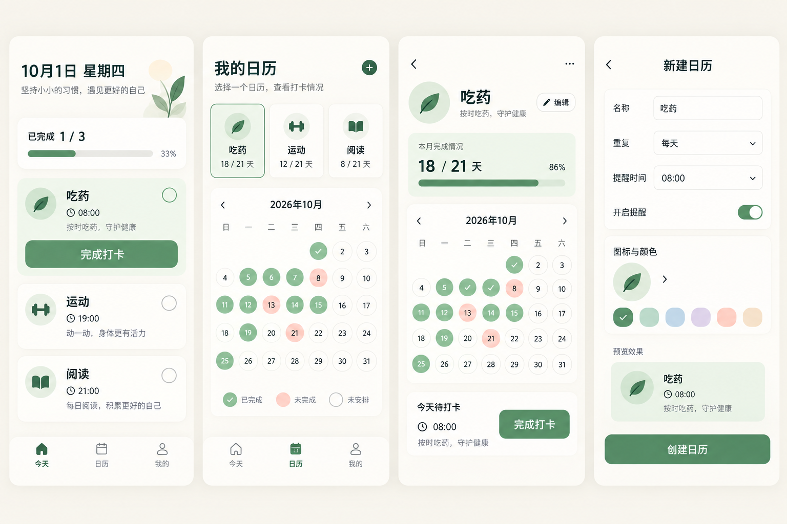
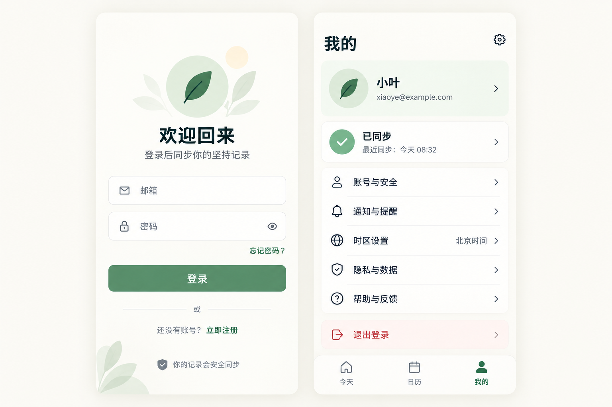

# 个人日历：原型与开发计划

更新日期：2026-10-01
GitHub 仓库：`personal-calendar`（私人仓库）

> 当前实施范围调整：先交付按原型设计的本地可用版本，包括日历、打卡、编辑/暂停与手机提醒。账号、云同步和数据备份暂缓；下文相关章节保留为后续规划。

## 1. 产品目标与第一版范围

为个人创建多个相互独立的“坚持日历”。用户可为每个日历命名，设置每天或每周指定星期、每日一次打卡和一个提醒时间；“吃药”只是第一个普通日历，不做药品、剂量或处方管理。日历展示已完成、已错过、未来待完成和未安排四种日期状态。过了当天仍未打卡的计划日自动显示为未完成；第一版不提供补签。

第一版支持邮箱密码注册、邮箱验证、登录和找回密码；数据先写入手机，离线可查看、打卡和接收本地提醒，联网后与账号同步。先提供给本人和少量测试者使用，不在这一阶段公开发布。界面使用中文、温和的浅色与鼠尾草绿，优先保证大按钮、清晰状态和无障碍可读性。

## 2. 原型

核心页面：今天、日历列表、单个日历详情、新建日历。

账号页面：登录、我的。注册、邮箱验证和找回密码沿用登录页的视觉样式。

图片是视觉概念稿，里面的日期、完成率、账号与示例记录不代表真实逻辑或真实用户数据。实际开发以本计划中的状态规则和接口行为为准。

### 主要交互

1. 登录后进入“今天”，按当前日历时区列出今日计划，点“完成打卡”立即更新本地状态；同步中显示“待同步”，失败时保留记录并提示重试。
2. “日历”先显示不同日历的独立入口，选择后查看月历、月度完成情况及当天打卡。未安排日期不计入完成率；未来日期不显示为漏打卡。
3. 新建或编辑日历时填写名称，可选图标、颜色和备注，选择“每天”或指定星期，设置提醒时间及开关。日历可暂停和恢复；暂停期间不生成计划或提醒。
4. 到点显示 Android 本地通知，点击通知进入对应日历。通知权限或精确闹钟权限缺失时，页面说明影响并提供系统设置入口。
5. “我的”显示账号、最近同步状态、通知权限、时区和隐私数据入口；退出登录后清除本机该账号的会话与缓存，不删除云端数据。

## 3. 技术选型

| 部分 | 选型 | 用途与边界 |
| --- | --- | --- |
| 安卓客户端 | Kotlin、Jetpack Compose、Material 3；最低 Android 8.0（API 26） | 只做安卓原生应用；按现行稳定 SDK 构建和测试。 |
| 本地数据 | Room、DataStore | Room 保存日历、打卡、同步队列；DataStore 保存少量应用设置。本地数据库按账号隔离。 |
| 本地提醒 | AlarmManager、通知渠道、BroadcastReceiver | 用户设定时间尽量准点提醒；处理通知权限、精确闹钟权限、重启和时区调整。系统拒绝精确权限时降级并明示可能延迟。 |
| 后台同步 | WorkManager | 网络恢复后按序重试待同步操作，采用有限重试和退避；提醒本身不依赖网络。 |
| 身份认证 | Amazon Cognito User Pool、Amplify Android Auth | 邮箱密码、验证、找回密码；移动端不内置客户端密钥，不让手机直接持有数据库权限。 |
| 同步 API | API Gateway HTTP API、AWS Lambda（TypeScript） | 由 JWT 授权器保护；服务端以令牌用户标识限定所有日历和打卡读写。 |
| 云端数据 | Amazon DynamoDB | 存储用户设置、日历和打卡；按用户及日历/日期查询，不扫描其他用户数据。 |
| 基础设施 | AWS CDK（TypeScript）、CloudWatch | 将认证、API、数据库、日志和告警定义为代码，区分测试与正式环境。 |
| 接入与加速 | AWS 全球区香港区域 `ap-east-1`、CloudFront Global | 现有账号只有 AWS 全球区；CloudFront 作为 API 入口，个人接口禁用缓存并转发认证头。与 API 直连进行大陆网络实测，不预设加速效果。 |

采用 Android 推荐的离线优先数据层：界面只读取本地数据，操作先持久化，再通过队列同步。CloudFront 对每位用户的动态接口不得缓存响应。[Android 离线优先指南](https://developer.android.com/topic/architecture/data-layer/offline-first)、[CloudFront 授权头与缓存说明](https://docs.aws.amazon.com/AmazonCloudFront/latest/DeveloperGuide/add-origin-custom-headers.html)。

## 4. 数据、接口与一致性

- **用户设置**：用户 ID、可选昵称、日历时区（默认 `Asia/Shanghai`）。日期判断和提醒时间均以该时区为准；修改时区后重新计算未来提醒。
- **日历**：UUID、所属用户、名称、备注、图标、颜色、开始日期、重复规则（每天或星期集合）、每日提醒时间及开关、暂停状态、版本号。名称去除首尾空白且不能为空；用户可创建同名日历，因为 UUID 才是唯一身份。
- **打卡**：以“日历 ID + 当地日期”为唯一键，每个计划日最多完成一次。过去未完成是按规则计算出的状态，不预先写入漏打卡记录。重复提交返回同一完成结果，不重复计数。
- **同步操作**：每次写入带稳定操作 ID；服务端记录已处理 ID 以防网络重试造成重复副作用。客户端先保存本地变更和待同步操作，WorkManager 联网后上传，再拉取云端变更。离线当天形成的打卡即使次日才上传，也按原打卡日期保存；界面不提供事后补签入口。
- **并发编辑**：日历更新使用版本号条件写入；若另一设备先修改，服务端返回冲突，客户端保留本地草稿，展示云端版本并让用户重试，不静默覆盖。
- **接口契约**：`GET/POST /v1/calendars`、`PATCH /v1/calendars/{id}`、`GET /v1/calendars/{id}/check-ins?month=YYYY-MM`、`PUT /v1/calendars/{id}/check-ins/{date}`、`GET/PATCH /v1/me`。写入携带操作 ID，日历修改携带版本号；统一返回明确的校验、未授权、冲突和服务失败结果。所有资源在服务端按当前用户验证归属。
- **隐私**：传输走 HTTPS；不在代码、原型和日志中放密码、令牌或实际健康记录，日志仅保留定位问题所需的匿名标识。提供隐私说明和账号数据删除入口；删除账号须同时清理用户云端数据与本地缓存。

## 5. 开发事项与流程

采用“设计确认 → 测试先行 → 最小实现 → 验证 → 提交”的小步流程。每项任务在独立分支完成，PR 中附上测试结果和页面截图；不在未验证的情况下合并。下列阶段依次推进，每阶段交付可运行或可验证的增量。

1. **工程与设计基线**：创建 Android、后端和 CDK 工程；固定颜色、字号、组件和导航；实现六个原型页面的静态状态、空状态、加载状态与错误状态。验证中文显示、键盘操作与常见手机尺寸。
2. **账号与云端基础**：部署 Cognito、HTTP API、Lambda 和 DynamoDB；实现邮箱注册/验证/登录/找回密码、JWT 校验、用户归属和最小日历接口。使用测试账号验证未授权、越权和重复请求。
3. **日历与打卡**：完成 Room 模型、创建/编辑/暂停日历、今天列表、月历及每日一次打卡；先写日期/星期/时区和状态边界测试，再接入界面。
4. **本地提醒**：实现通知渠道、权限引导、下一次提醒计算及系统闹钟调度；创建、编辑、暂停、打卡、重启、权限变化和时区变化都要取消或重排相关提醒。
5. **离线同步**：实现待同步队列、幂等写入、增量拉取、版本冲突展示和同步状态。双设备及断网重连演练确保不丢打卡、不重复计数。
6. **测试版部署与验收**：在 AWS 全球区香港区域部署测试环境，通过 CloudFront 和 API 直连分别在大陆网络测试登录、同步、延迟与失败率；修复实际问题，生成签名测试 APK，交付少量测试者。

## 6. 验收清单

- 每个日历的名称、规则、月历、统计和提醒互相独立；“吃药”不出现药品专属输入。
- 每天和指定星期的计划、月末、跨年、时区变更、暂停/恢复的日期状态正确；未安排日不计入完成率。
- 同一计划日重复点击或重试只完成一次；离线打卡立即可见，重连后同步到第二台设备。
- Android 13+ 通知权限和 Android 12+ 精确闹钟权限被拒绝时有可理解的反馈；重启后提醒重新安排。实际设备上的电池限制可能影响准点性，测试记录机型和结果。
- 注册、邮箱验证、登录、找回密码、退出登录和删除账号流程可用；未登录和跨用户请求无法读取或修改他人记录。
- 单元测试覆盖日期与状态规则、提醒计算和同步冲突；接口测试覆盖参数、授权、归属和幂等；真机验收覆盖通知、离线和多设备同步。

## 7. 上线前提与当前默认决定

- 当前只做私人仓库和小范围测试版。AWS 全球区香港区域及 CloudFront Global 是在“只有全球区账号”的条件下选择的测试部署方案；CloudFront 中国区需要中国区条件及已备案域名，不能直接用现有全球区账号替代。[AWS 中国内容交付说明](https://aws.amazon.com/cn/developer/application-security-performance/articles/content-delivery-in-china/)
- 大陆用户经全球区访问的可用性和时延必须以实测为准。正式对公众开放前，另行评估域名、数据处理、隐私与适用的上线要求。
- 第一版不做 iOS、家人代管、药品剂量、库存、云推送、补签、连续奖励或复杂统计。通知为手机本地定时通知，不承诺第三方手机系统在所有省电模式下绝对准点。
