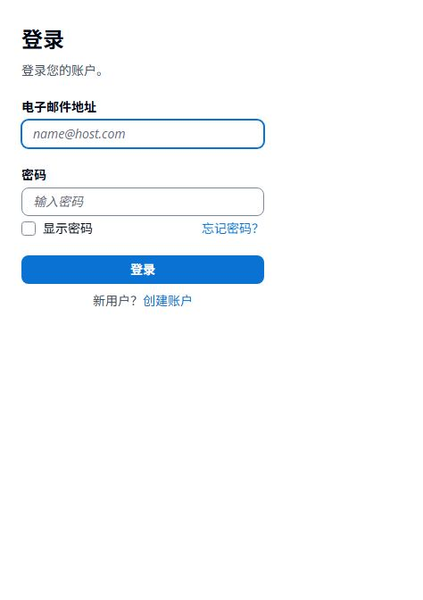

# 整月计划与中文登录

## 已确认目标

- 月度分母计算所选月份的全部计划日，创建当月从创建日开始；分子仅计算截至今天真实完成的计划日。
- 保留历史排期、暂停、编辑次日生效、北京时间和不能提前打卡等规则。
- 保留 Cognito 账号与授权码 PKCE，使用新版 Managed Login 和 `lang=zh-CN` 提供中文登录、注册与找回密码页面。

## 实施步骤

1. 增加月中创建、指定星期、跨月、闰年、暂停与次日生效规则回归；调整全月统计和列表规则查询上界。
2. 更新列表、详情说明和界面测试，让分母含义可见；不修改数据库结构和打卡记录。
3. 增加中文授权参数回归；CDK 使用 Managed Login v2，并为现有客户端创建托管样式，保持用户池、客户端和存储逻辑 ID。
4. 运行安卓测试/构建/Lint、云端类型检查/测试/synth；有有效 AWS 会话后先检查 diff，再只部署相关数据堆栈，并核验中文页面。
5. 更新项目规范与说明，构建递增版本测试包，核验签名、云配置和摘要，交付真实验证结果。

## 原因与边界

旧统计将计划日限制到今天，因此 10 月 3 日开始的每日任务在 10 月 10 日分母为 8。新口径下十月为 29，后续月份按整月排期计算。暂停或调整星期会改变未来计划总数，不重写过去。

旧版 Cognito Classic Hosted UI 不支持本地化；新版 Managed Login 支持简体中文。当前 CDK 已使用 Essentials 计划，无需为此改用户池计划或自建密码服务。部署时仍须核验实际资源。切换页面版本会让浏览器登录会话重新认证。

参考：[AWS Managed Login 本地化](https://docs.aws.amazon.com/cognito/latest/developerguide/cognito-user-pools-managed-login.html)。页面语言不自动控制邮件模板，也不保证大陆所有网络均可访问。

## 2026-10-10 验证与交付

- 安卓：先运行新增/调整的回归，旧实现出现预期的分母与语言参数断言失败；修复后完整执行 `:app:testDebugUnitTest :app:assembleDebug :app:lintDebug`，44 项测试通过，Lint 0 错误、11 条既有警告。构建还提示 SDK XML 工具版本差异，未阻止构建。没有更改数据库版本、记录或备份协议。
- 云端：`npm run check`、7 项测试及严格 synth 通过。先部署开发环境，再通过 CloudFormation 变更集审查生产差异，最后部署生产 Data 堆栈。变更为登录版本 1→2、新增客户端样式、修正原权限描述中的问号及 CDK 元数据；没有替换用户池、客户端或存储桶，没有修改套餐、预算、API 或 Lambda。
- 生产域名读取确认 `ACTIVE`、`ManagedLoginVersion=2`，客户端托管样式存在。浏览器实际确认生产登录页为中文；开发环境注册、密码规则及找回密码页面也为中文。未输入账号密码、未创建测试用户、未触发验证邮件或重置密码。
- Android 请求添加 `lang=zh-CN`；应安装新版 APK，旧版没有明确语言参数，首次访问仍可能显示英文。
- APK：`0.3.2` / `versionCode=5`，包名保持 `com.hang2515.personalcalendar`，调试签名与 0.3.1 一致。生产 API、授权域名、客户端 ID 均匹配既有部署输出。
- APK SHA-256：`77b09c0d39855d108530d4ade5d1ed4d27590ebb952078c41dbff2c220c0d29b`。
- 当前未连接真机，实际手机账号登录回跳、邮件收取及大陆不同网络仍待验收。

